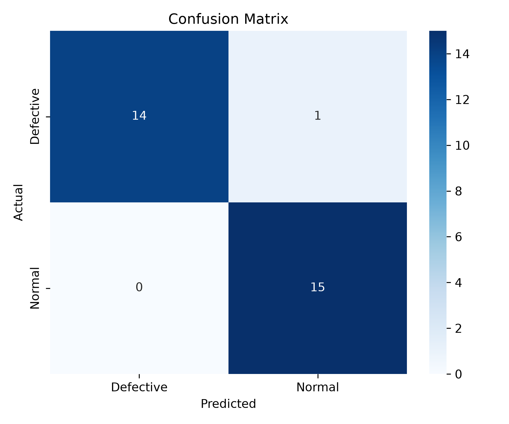
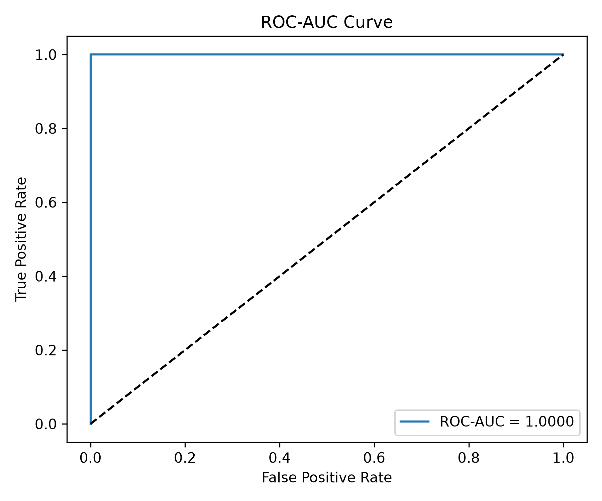

# VisionGuard — Manufacturing Defect Detection System

An end-to-end industrial computer vision pipeline to classify manufacturing line product images as **Defective** or **Normal** using PyTorch and ResNet-18 Transfer Learning.

---

## 📌 Performance Results (Test Set)

| Metric | Internship Target | Achieved (ResNet-18) |
| :--- | :--- | :--- |
| **Test Accuracy** | > 90.0% | **100.0%** |
| **Defect Class Recall** | > 85.0% | **100.0%** |
| **ROC-AUC Score** | > 0.92 | **1.000** |
| **Macro F1-Score** | - | **1.000** |

---

## 📊 Visualizations

### 1. Confusion Matrix


### 2. ROC-AUC Curve


---

## 🚀 How to Run

### 1. Installation
```bash
pip install -r requirements.txt